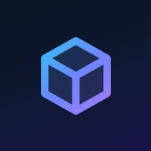
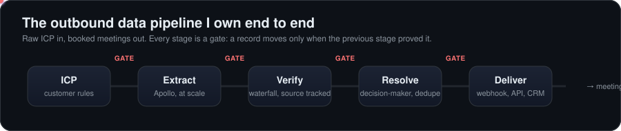

<div align="center">



</div>

<div align="center">

<a href="https://mdrobeulislam1251-ux.github.io/robeul-console/"></a>

<sub>👋 Welcome. The README is the summary; <a href="https://mdrobeulislam1251-ux.github.io/robeul-console/"><b>the console</b></a> is the full walkthrough.</sub>

</div>

<table>
<tr>
<td width="200" align="center" valign="middle">
  
</td>
<td valign="middle">

### GTM Data Systems · Agent Infrastructure · Self-Hosted Ops

I build the data and automation systems that turn a raw ICP into booked meetings, plus the self-hosted infrastructure they run on. I own an outbound pipeline end to end: extraction, waterfall verification, decision-maker resolution, delivery. I lead a data engineering team for two US lead-generation companies, and I build multi-agent AI systems that are verified before they are allowed to say "done".

<a href="mailto:mdrobeulislam1251@gmail.com"></a>
<a href="https://www.linkedin.com/in/mdrobeulislam1251"></a>
<a href="https://github.com/mdrobeulislam1251-ux"></a>
<br/>


</td>
</tr>
</table>

<div align="center">

<a href="https://github.com/mdrobeulislam1251-ux">
  
</a>

</div>

<br/>

## 💼 Experience

<table>
<tr>
<td width="72" align="center" valign="top"></td>
<td valign="top">

**Head Data Engineer · [Trusted Leads](https://trustedleads.io)**
<sub>Aug 2024 – Present · Full-time · Remote · St. Petersburg, FL (US)</sub>

Own the outbound data infrastructure end to end: the extraction engine and the pipeline it feeds. ICP-based prospect extraction from Apollo.io, driven by each customer's own targeting rules. Waterfall email verification across several providers, with the source tracked on every record. Decision-maker resolution, deduplication against past deliveries, schema-consistent normalisation. Delivery by webhook and direct API into Smartlead, Instantly and customer CRMs. Lead the data engineering team and set the schema and verification standards.

        

</td>
</tr>
<tr>
<td width="72" align="center" valign="top"></td>
<td valign="top">

**Senior Data Engineer · [Lead Gen Jay](https://leadgenjay.com)**
<sub>Aug 2024 – Present · Contract · Remote · St. Petersburg, FL (US)</sub>

Large-scale prospect extraction, enrichment and verification for a data team that ships lead lists at volume. ICP segmentation and list building against each customer's targeting criteria. Email verification and data-quality checks before delivery, so every list is ready to send. When a campaign underperforms, find the cause (list building, data accuracy or mailbox health) and fix the pipeline upstream so it does not happen again.

      

</td>
</tr>
<tr>
<td width="72" align="center" valign="top"></td>
<td valign="top">

**Founder · [Outboundrix LLC](https://outboundrix.io)**
<sub>2026 – Present · Wyoming, US</sub>

Founded and incorporated a US company. Planned and ran a multi-phase infrastructure move from one overloaded VM to two: a data layer and an application layer. Migrated the app, auth (Authgear), API gateway (KrakenD), n8n, Elasticsearch, PostgreSQL and PocketBase. Caught the n8n encryption-key risk before cutover, which would otherwise have wiped every stored credential. Built email infrastructure on Amazon SES across two regions with full DNS, inside a deployment scaffold that runs checks before and after each step.

       

</td>
</tr>
</table>

<div align="center">

</div>

<br/>

## 🧩 Selected projects

| | Project | What it does |
|:--:|---|---|
|  | **Verification-gated multi-agent development system** · 2026, own project | Built to stop AI coding agents from reporting work as complete when it never ran. Stop hooks keep an agent from ending its turn until a verification gate passes. Guards catch destructive commands before they run. Role locks stop a builder approving its own work. A separate reviewer model checks the builder, and a budget circuit breaker kills runaway loops. Runs the full loop: issue, code, error monitoring, deploy. <br/><sub>Claude Agent SDK · TypeScript · Supabase · MCP · Coolify · Vercel</sub> |
|  | **Distributed Apollo scraping orchestrator** · 2025, Trusted Leads | Seven n8n workflows: session intake, keep-alive probing, account warm-up promotion, order intake, job splitting, scrape dispatch, worker callbacks, plus a shared error-handling workflow. Manages a pool of authenticated sessions, promotes warmed accounts, retires failed ones, and splits large orders into parallel jobs. Job state lives in versioned PostgreSQL tables, so every order has an auditable record from intake to delivery. <br/><sub>n8n · PostgreSQL · Python · Docker · webhooks</sub> |
|  | **Self-hosted infrastructure fleet** · 2024, Trusted Leads | Designed and run the servers the pipelines use, split by role across several regions, plus a main container host for scraping, agent tooling and document processing. All server-to-server traffic goes over a private Tailscale network. No service is public unless deliberately published. Containers bind to the private address, and boot order brings the network up before them. <br/><sub>Docker Compose · Ubuntu · Tailscale · Cloudflare · UFW · systemd · Caddy · libvirt/KVM</sub> |
|  | **[T-Ex LLM Runpack](https://github.com/mdrobeulislam1251-ux/T-Ex-LLM-Runpack)** · 2026, own project | Per-engineer AI agent environments: a ready-to-deploy setup each engineer runs on their own server, with a private network, individually issued keys, remote SSH development and one branch per engineer. Ships per-project context files, so new engineers are productive on day one and one project's assumptions never leak into another. 53 specialist agents, 44 doctrine skills, hard review gates. <br/><sub>Claude Code · NanoClaw · Tailscale · Git · Linux · VS Code Remote-SSH</sub> |

<br/>

## 🛠️ Skills

<div align="center">

</div>

| Track | What I actually use |
|---|---|
| **AI & Agents** | Claude Agent SDK, Claude Code, multi-agent orchestration, MCP, agent reliability and enforcement hooks, prompt and context engineering, local LLM inference (vLLM, Qwen), retrieval and personalisation pipelines, AI-assisted prototyping |
| **Data** | Python, PostgreSQL, Supabase, ETL / ELT pipelines, web scraping at scale, waterfall verification, deduplication and identity resolution, schema design, data-quality auditing |
| **Automation & APIs** | n8n multi-workflow systems and error workflows, REST / RPC API design, webhooks, Next.js API routes, FastAPI, Express, API gateways (KrakenD), auth (Authgear), rate limiting and retries |
| **GTM Systems** | Apollo.io, ICP design and segmentation, B2B list building, enrichment, email verification (MillionVerifier, Reacher), deliverability, Smartlead, Instantly, CRM integration, RevOps data modelling |
| **Infrastructure** | Docker, Docker Compose, Linux (Ubuntu), Coolify, Tailscale, Cloudflare Tunnels, Caddy, AWS SES, DNS, UFW, systemd, KVM virtualisation, Vercel, server migration |
| **Languages** | Python, TypeScript, JavaScript, SQL, Bash · Next.js, React, Node.js |
| **Professional** | Team leadership, root-cause diagnosis, client-facing problem solving, technical documentation and standards, founding a business, async remote work with US teams |

<div align="center">

<a href="https://skillicons.dev">
  
</a>

<br/><br/>

<sub>GTM tools I run every day</sub><br/>
&nbsp;&nbsp;
&nbsp;&nbsp;
&nbsp;&nbsp;
&nbsp;&nbsp;
&nbsp;&nbsp;


</div>

<br/>

## 🔄 The pipeline

<div align="center">

</div>

<br/>

## 🏢 Companies and products

<table>
<tr>
<td width="60" align="center"></td>
<td><b><a href="https://trustedleads.io">Trusted Leads</a></b> · the agency brand<br/><sub>Apollo-grade B2B contact and company lists as a service. Elasticsearch for raw scrape, Postgres as the system of record, OpenSearch via an outbox, a verifier that alone may mark a row valid. Internal search dashboard over ~17.4M contacts, 69 filter fields, exports to 600k rows.</sub></td>
</tr>
<tr>
<td align="center"></td>
<td><b>Datryxen</b> · the self-serve SaaS face<br/><sub>Same GTM data engine, sold as a product. Submit an ICP, an Apollo URL, a Maps or LinkedIn scrape; track delivery; manage credits; push to integrations. Next.js 16, React 19, Tailwind v4, Postgres.</sub></td>
</tr>
<tr>
<td align="center"></td>
<td><b><a href="https://outboundrix.io">Outboundrix</a></b> · GTM execution engine<br/><sub>Prospecting and cold-email outreach in one product: Workspace / M365 / SMTP sending, warmup, sequences, AI personalisation, unified inbox, REST API and webhooks. Next.js on Postgres, Vercel cron workers, n8n.</sub></td>
</tr>
<tr>
<td align="center"></td>
<td><b><a href="https://github.com/mdrobeulislam1251-ux/T-Ex-LLM-Runpack">T-Ex LLM</a></b> · company-in-a-box for terminal AI<br/><sub>53 specialist agents in 9 teams, 44 doctrine skills, a switchable company brain, hard review gates. Ships as a Claude Code plugin, a standalone launcher, and a self-hosted runtime with WhatsApp / Telegram channels.</sub></td>
</tr>
<tr>
<td align="center"></td>
<td><b><a href="https://www.readylist.ai">Ready List</a></b> · campaign factory<br/><sub>Brief in, reviewed campaign out as a PR on the customer's own repo. One customer, one repo, one VPS.</sub></td>
</tr>
</table>

<br/>

## 📜 The doctrine

Six words, then seven kill switches. These live in the brain every agent loads before it touches my work.

<div align="center">

### `NO GUESS` · `NO TRUST` · `GREEN CHECK` · `STOP ON RED` · `IDEMPOTENT` · `NO FAKE DONE`

</div>

| # | Kill switch | What it means in practice |
|:-:|---|---|
| 1 | **Stop at the endpoint** | count ≠ pull ≠ deliver. fix ≠ commit ≠ push. Do the named step, then stop. |
| 2 | **Did he name this action?** | A request is the approval for that request, and nothing adjacent to it. |
| 3 | **No auto-spend** | No credits, no paid API calls, no purchases without a named go. |
| 4 | **No client file** until row count and ICP are approved | Reputation is the product. A bad list costs more than a late one. |
| 5 | **No paid recommendations** without a test | Prove it on a sample before proposing the spend. |
| 6 | **No identical essays** | A repeated explanation is a sign the work is not being done. |
| 7 | **Verify before claim** | "Done" means it ran and was observed passing. Exit code 0 means compiled, never works. |

<details>
<summary><b>Operating rules, distilled from a 571-session audit</b></summary>

```text
1  NO FALSE DONE                      5  REMOVE, DON'T ADD
2  BUILD ONLY THE NAMED NOUN + PATH   6  ONE WORKSPACE, DEPLOY IT
3  STOP GAZING, LOAD STATE FIRST      7  ON ANGER -> KILL, THEN ACT
4  FOLLOW HIS DOCUMENTED PATTERN
```

**How to work with me**, as written for the agents: default to execution, not questions. No A/B/C menus; I would rather correct a confident default than narrate a spec from scratch. Minimum-viable-correct: do it natively, don't over-build. Finish one layer before the next. Stuck means "tried X, saw Y, stuck at Z". Three failed attempts or two repeated corrections is a hard stop. Surface the real bottleneck, which is often human or supply, not code.

</details>

<details>
<summary><b>In my own words</b> — what I actually typed into agent sessions</summary>
<br/>

> "I wouldn't love to work with an AI agent that keeps me questioning all the time, saying plans and forcing me to submit commands. The agent should behave like my real worker."

> "If something is actually not possible with the current resources, say so honestly, rather than trying it with a 0% chance of winning."

> "Stop the circling. Complete the config, done, or say not possible."

> "You had the SSH access. Why are you asking me to execute it all myself?"

</details>

<details>
<summary><b>Lessons that became rules</b></summary>
<br/>

| Lesson | Rule it produced |
|---|---|
| A test was run against live accounts instead of a sandbox | Never test against production identities |
| A destructive mistake was quietly repaired | Never hide it. Postmortem first, then fix |
| The tool I prefer got built instead of the tool that was asked for | Build the named noun, not the preferred one |
| A search cluster was overloaded by an unthrottled batch | Throttle, measure, then scale |
| A process kill took out its own SSH shell | Never cut your own access |
| A session asked to inspect one host changed another | Touch only the host named in the request |
| Repeated sessions ended with plans instead of working config | One small goal, verify from the client side, record, then expand |

</details>

<br/>

## 🧠 The second brain

The brain is a file system, not a chat history. It is versioned, so it survives machines. "One machine + GitHub, nothing else."

<div align="center">

| 541 | 3,141 | 571 | 7 | 53 / 44 |
|:---:|:---:|:---:|:---:|:---:|
| curated notes | archived session logs | sessions audited for the operating rules | kill switches | agents / doctrine skills in the runpack |

</div>

- **Live beats notes.** A wrong fact in the brain is worse than no fact. Every fact carries the command that proved it and the date.
- **Write down what was decided, not what was done.** Git records the doing. The brain records the why, and what was tried and rejected.
- **An emotion governor, not feelings.** A prompt hook classifies each message as Frustrated, Correction, Build, Ask or Focus and changes how the agent responds. Frustration means stop, load state, then act.
- **Per-project brains** with boundaries, verified state, and a verification recipe, loaded at session start.

<br/>

## 🔁 The dev loop, with its six guarantees

<table>
<tr>
<td width="50%" valign="top">

| # | Guarantee | Mechanism |
|:-:|---|---|
| 1 | Work commits on the dev server **through gates** | typecheck · API-drift · sweep contract. Fail = no commit, error posted to the issue. Edits refused until an issue is claimed. |
| 2 | The dev server **cannot push** to GitHub | No token, no helper, no `gh`. `git push` denied in settings. |
| 3 | Server → laptop **only when I ask** | No cron, no watcher, no timer. |
| 4 | Laptop → GitHub on **one dev branch** | Branch hardcoded in the publisher; protected branches refused server-side. |
| 5 | The owner merges **when I say** | `main` is read-only to the whole system. |
| 6 | **No credentials ever reach GitHub** | A content-scanning guard aborts on JWTs, live keys, tokens, private keys. Full history stays home. |

</td>
<td width="50%" valign="top">

```text
laptop   open the right workspace
agent    claim an issue        -> edits unlock
         build -> run -> observe  screenshots, curls
         commit through gates  -> fail blocks + logs
me       publish from laptop   -> guard first, read back
         deploy                -> pull-based, /health must answer
         say when to merge     -> main stays the owner's
```

Review gates by deliverable, from the runpack:

| Deliverable | Gate |
|---|---|
| Schemas, migrations, architecture | cto |
| UI implementation | design-system-engineer |
| AI / prompt changes | ai-eval-engineer |
| Bug fixes | regression-tester |
| Releases | engineering-manager + qa-automation |

</td>
</tr>
</table>

<br/>

## 📊 Stats

<div align="center">


<br/>


<br/><br/>


<br/>


<br/><br/>


<br/>

<picture>
  <source media="(prefers-color-scheme: dark)" srcset="https://raw.githubusercontent.com/mdrobeulislam1251-ux/mdrobeulislam1251-ux/output/github-snake-dark.svg" />
  
</picture>

</div>

<br/>

## 🤝 Connect

<div align="center">

<a href="https://mdrobeulislam1251-ux.github.io/robeul-console/"></a>
<a href="mailto:mdrobeulislam1251@gmail.com"></a>
<a href="https://www.linkedin.com/in/mdrobeulislam1251"></a>
<a href="https://github.com/mdrobeulislam1251-ux"></a>
<a href="https://outboundrix.io"></a>
<a href="https://trustedleads.io"></a>

<br/><br/>
<sub>Remote on US hours from Bangladesh. Open to data-engineering and agent-infrastructure conversations.</sub>


</div>
